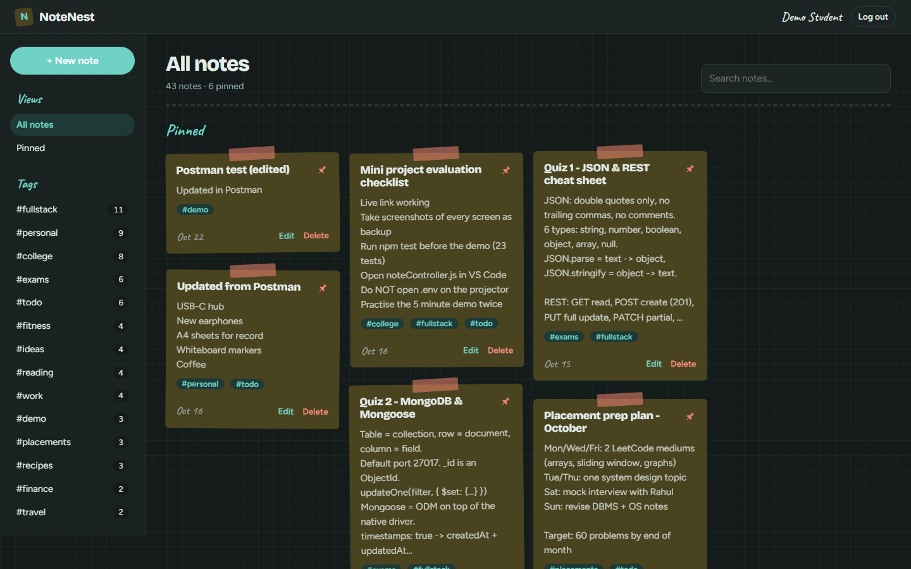
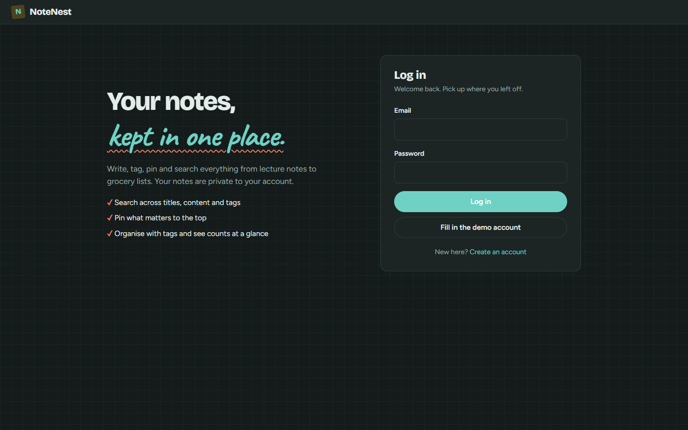

# NoteNest: Personal Notes App (MERN)


A secure note-taking app where each user can **create, edit, delete, search, tag and pin** their own notes.
Built with **MongoDB, Express, React and Node.js**.

> Full Stack Frameworks mini project, Project 1: Personal Notes App

**Live demo:** https://notenest-notes-app.vercel.app

**Demo account:** `demo@notenest.app` / `demo123` (40 sample notes; or click "Fill in the demo account" on the login page)

## Screenshots

| Notes dashboard | Login |
| --- | --- |
|  |  |

---

## Features

| Feature | How it works |
| --- | --- |
| Sign up / log in | Passwords hashed with **bcrypt**, sessions use a **JWT** |
| Protected routes | Express `protect` middleware on the API, `ProtectedRoute` in React |
| User data isolation | Every query filters by `user: req.user._id`; another user's note returns **404** |
| Full CRUD | Create, read, update and delete notes through the REST API |
| Search | Case-insensitive search across title, content and tags (debounced as you type) |
| Tags | Comma-separated tags, stored lowercase without duplicates; sidebar lists every tag with its note count (MongoDB aggregation) |
| Pin notes | Pinned notes are sorted first and shown in their own section |
| Filters | By tag and pinned status, kept in the URL so a refresh keeps them |
| Validation | Mongoose schema validation on the server and form validation in React |
| Loading / error states | Spinners, disabled buttons while saving, error banners with retry, success messages |
| Timestamps | `createdAt` and `updatedAt` added automatically by Mongoose |
| Responsive UI | Works on phones and desktops, with light and dark mode |

## Tech stack

- **Frontend:** React 19 (Vite), React Router, Axios, Context API
- **Backend:** Node.js, Express 5, Mongoose, JSON Web Tokens, bcryptjs
- **Database:** MongoDB Atlas
- **Testing:** Node.js built-in test runner (`node --test`), Supertest and mongodb-memory-server (23 API tests)
- **Deployment:** Vercel (React static site and Express API as a serverless function)

## Project structure

```
notes-app/
├── server/
│   ├── index.js              # starts Express and connects to MongoDB
│   ├── app.js                # Express app: middleware and routes
│   ├── config/db.js          # Mongoose connection
│   ├── models/
│   │   ├── User.js           # name, email, hashed password
│   │   └── Note.js           # user, title, content, tags, pinned, timestamps
│   ├── middleware/
│   │   ├── auth.js           # JWT "protect" middleware
│   │   └── errorHandler.js   # turns errors into JSON responses
│   ├── controllers/          # route logic
│   ├── routes/               # URL to controller mapping
│   └── tests/api.test.js     # automated API tests
├── client/                   # React app (Vite)
│   └── src/
│       ├── api/client.js     # Axios instance and API calls
│       ├── context/AuthContext.jsx
│       ├── components/       # Navbar, NoteCard, ProtectedRoute, Spinner
│       └── pages/            # AuthPage, NotesPage, NoteFormPage, NotFoundPage
├── api/index.js              # Vercel serverless entry point
├── docs/                     # Postman collection and REST Client file
└── vercel.json
```

## Database schema

**User**

| Field | Type | Rules |
| --- | --- | --- |
| name | String | required, max 50 |
| email | String | required, unique, lowercase, valid email |
| password | String | required, min 6, bcrypt-hashed, hidden from queries |
| createdAt / updatedAt | Date | automatic |

**Note**

| Field | Type | Rules |
| --- | --- | --- |
| user | ObjectId (ref User) | required, indexed: the owner |
| title | String | required, max 100 |
| content | String | max 10,000 |
| tags | [String] | lowercase, trimmed, no duplicates, max 10 |
| pinned | Boolean | default `false` |
| createdAt / updatedAt | Date | automatic |

## REST API

All `/api/notes` routes need the header `Authorization: Bearer <token>`.

| Method | Endpoint | Description |
| --- | --- | --- |
| POST | `/api/auth/register` | Create an account, returns `{ token, user }` |
| POST | `/api/auth/login` | Log in, returns `{ token, user }` |
| GET | `/api/auth/me` | Get the logged-in user |
| **GET** | **`/api/notes`** | List my notes. Query: `?search=`, `?tag=`, `?pinned=true/false` |
| **POST** | **`/api/notes`** | Create a note |
| GET | `/api/notes/:id` | Get one note |
| **PUT** | **`/api/notes/:id`** | Update a note |
| **DELETE** | **`/api/notes/:id`** | Delete a note |
| PATCH | `/api/notes/:id/pin` | Toggle pinned |
| GET | `/api/notes/tags` | My tags with note counts: `[{ "tag": "exams", "count": 6 }]` (aggregation pipeline) |
| GET | `/api/health` | Server and database status |

### Example JSON

`POST /api/notes`

```json
{
  "title": "Exam revision plan",
  "content": "Revise React hooks, Express middleware and Mongoose schemas",
  "tags": ["college", "exams"],
  "pinned": true
}
```

Response `201 Created`:

```json
{
  "_id": "6710c2f1a3b4c5d6e7f80912",
  "user": "6710c2a0a3b4c5d6e7f80901",
  "title": "Exam revision plan",
  "content": "Revise React hooks, Express middleware and Mongoose schemas",
  "tags": ["college", "exams"],
  "pinned": true,
  "createdAt": "2026-10-15T10:30:00.000Z",
  "updatedAt": "2026-10-15T10:30:00.000Z"
}
```

### Status codes

| Code | When |
| --- | --- |
| 200 / 201 | Success / created |
| 400 | Validation failed or invalid id |
| 401 | Missing, invalid or expired token, or wrong password |
| 404 | Note not found or not yours |
| 409 | Email already registered |
| 500 | Server error |

## Run locally

Requires Node.js 18+ and a MongoDB Atlas connection string.

```bash
# 1. Install dependencies
npm install
npm install --prefix client

# 2. Configure environment
cp .env.example .env      # then set MONGODB_URI and JWT_SECRET

# 3. Start the API (port 5000) and React (port 5173) together
npm run dev
```

Open http://localhost:5173.

Production mode (Express serves the built React app):

```bash
npm run build
npm start                 # http://localhost:5000
```

### Demo data

```bash
npm run seed                        # creates demo@notenest.app / demo123 with 40 notes
npm run seed -- you@example.com     # adds the 40 sample notes to an existing account (keeps its own notes)
```

Safe to re-run: it resets only the demo user's notes.

## Testing

```bash
npm test
```

The tests run against an in-memory MongoDB, so they never touch real data. They cover:

- register, login, duplicate email, short password, wrong password
- blocked access without a token or with an invalid token
- create, read, update, delete and pin notes
- search, tag filter and pinned filter
- validation errors (missing title, invalid id)
- **data isolation:** user B cannot read, edit or delete user A's notes

For manual testing, import `docs/NotesApp.postman_collection.json` into Postman, or open
`docs/api-requests.http` with the VS Code REST Client extension.

## Deployment (Vercel)

The React build is served as a static site and the Express app runs as a serverless function
(`api/index.js`). `vercel.json` sends `/api/*` to Express and everything else to React.

```bash
npx vercel login
npx vercel env add MONGODB_URI production
npx vercel env add JWT_SECRET production
npx vercel --prod
```

In Atlas, Network Access must allow `0.0.0.0/0`, because Vercel does not use fixed IP addresses.
